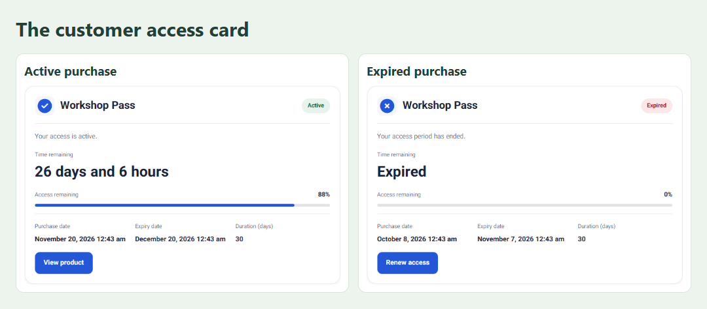

# Dastresi-Ban

Dastresi-Ban is a commercial WordPress plugin that grants time-limited access to protected content after a qualifying WooCommerce purchase. Admins can configure access rules and customise the card that shows a customer when their access expires.

[Read the English case study (PDF)](docs/Dastresi-Ban-WooCommerce-Case-Study.pdf) · [See the product on RTL Theme](https://www.rtl-theme.com/dastresiban-wordpress-plugin/)

## A 30-day workshop pass

The store admin links a lesson to a WooCommerce product with a 30-day access window. Two test customers open the same lesson URL in the local demo. The active buyer sees the lesson (HTTP 200). The expired buyer sees the configured access message (HTTP 403).

Customers can see their purchase date, expiry date, and time remaining. Admins can adjust the appearance of this card with a visual editor and live preview.

The screenshots show a local demo with sample orders. Interface labels were translated for the English portfolio.

## Code sample

The [purchase access sample](examples/purchase-access/README.md) includes the underlying order lookup and eligibility logic. Its integration fixture creates real WooCommerce orders in a disposable WordPress database to demonstrate the four access states and duration inheritance for variations.

The [template storage upgrade sample](examples/template-storage-upgrade/README.md) documents the legacy-data backup, tests an interrupted migration and verifies what remains after a successful retry.

## Licensing and materials

| Material | Published scope |
| --- | --- |
| Template storage upgrade sample | See the [GPL license in that sample](examples/template-storage-upgrade/LICENSE). |
| Purchase access excerpt | Selected Dastresi-Ban classes shared for portfolio review. See the [source note](examples/purchase-access/README.md#source). A separate redistribution license is unspecified. |
| Case-study PDF and screenshots | CodexaWP portfolio documentation. The migration sample's code license is scoped to that sample. |
