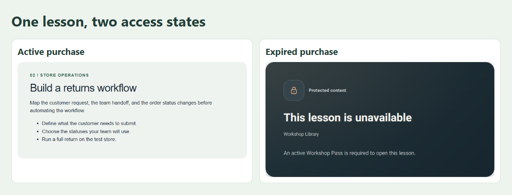

# Dastresi-Ban

**Commercial WordPress plugin by Amirhossein · CodexaWP.** A store needs to grant access after a qualifying WooCommerce purchase and expire it at the configured time. This case study follows the order eligibility logic and the migration of existing status-card templates and history.

[Product listing on RTL Theme](https://www.rtl-theme.com/dastresiban-wordpress-plugin/) · [English case study (PDF)](docs/Dastresi-Ban-WooCommerce-Case-Study.pdf) · [Migration verification](examples/template-storage-upgrade/README.md)

The migration keeps the original data and activates the new storage only after validation. The fixture interrupts the migration and verifies that a retry preserves the template IDs, default template, and history. The storefront outcome below was recorded on a disposable test shop.

## A 30-day workshop pass

The store admin links a lesson to a WooCommerce product with a 30-day access window. Two test customers open the same lesson URL in the local demo. The active buyer sees the lesson (HTTP 200). The expired buyer sees the configured access message (HTTP 403).

Customers can see their purchase date, expiry date, and time remaining. Admins can adjust the appearance of this card with a visual editor and live preview.

The screenshots show a local demo with sample orders. Interface labels were translated for the English portfolio.

## Code sample

The [purchase access sample](examples/purchase-access/README.md) includes the order lookup and eligibility logic. Its integration fixture creates synthetic WooCommerce orders for four access states and variation duration inheritance. The full product's page, shortcode and Elementor enforcement are outside this code sample.

The [template storage upgrade sample](examples/template-storage-upgrade/README.md) documents the legacy-data backup, tests an interrupted migration and verifies what remains after a successful retry.

## Licensing and materials

| Material | Published scope |
| --- | --- |
| Template storage upgrade sample | See the [GPL license in that sample](examples/template-storage-upgrade/LICENSE). |
| Purchase access excerpt | Selected Dastresi-Ban classes shared for portfolio review. See the [source note](examples/purchase-access/README.md#source). A separate redistribution license is unspecified. |
| Case-study PDF and screenshots | CodexaWP portfolio documentation. The migration sample's code license is scoped to that sample. |
