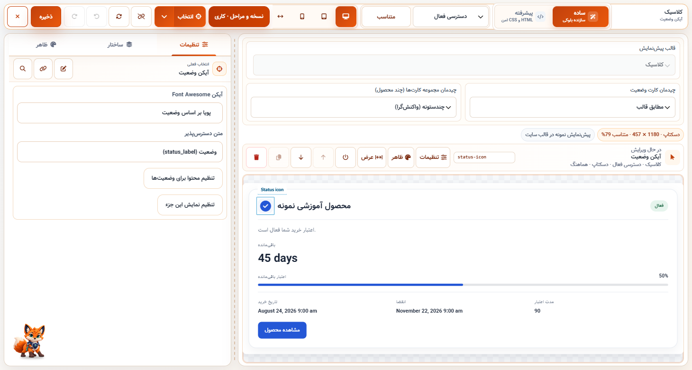

# Access Status Card Builder

The Dastresi-Ban editor lets a site owner design the card a customer sees after a purchase. Smaller breakpoints inherit desktop settings and can override them for a particular device or card orientation.

The example is taken from the computedStyles method in Dastresi-Ban 2.0.0. Templates saved without a styles map use the editor defaults. The fixture injects the original method's editor and style contracts.

    node --test tests/computed-styles.test.mjs

The checks cover device inheritance, orientation and preservation of the saved template.
