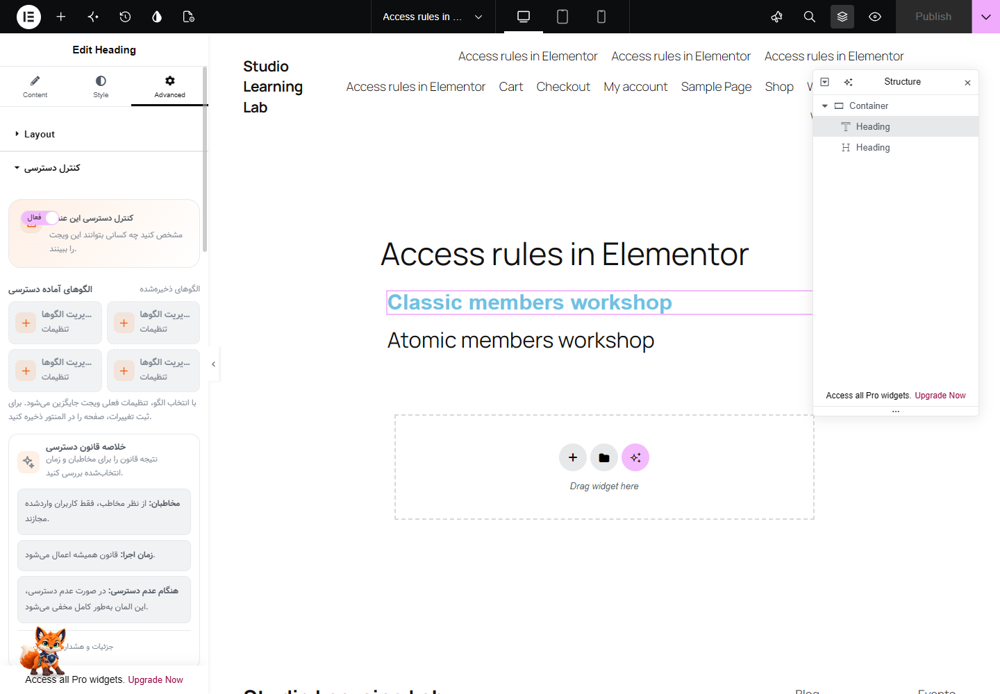
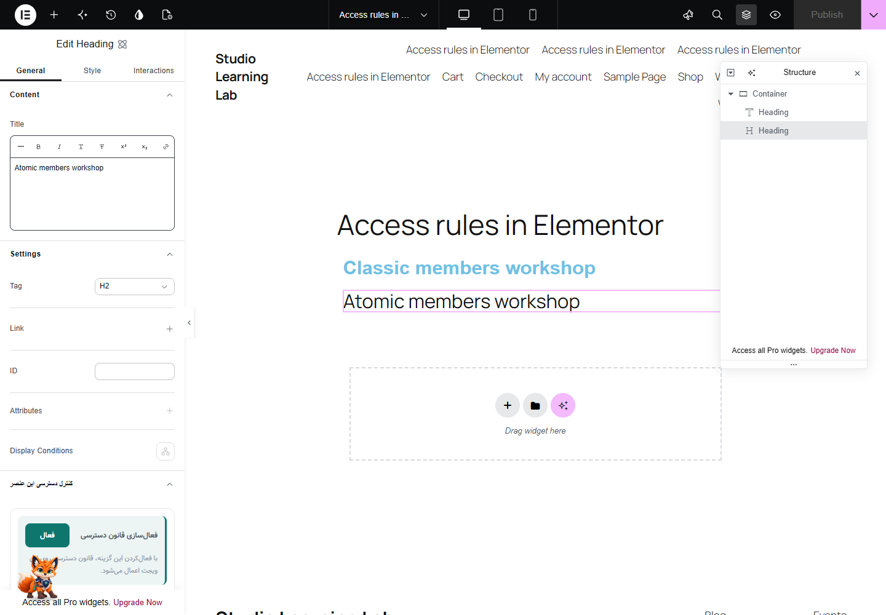

# Classic and Atomic Elementor access controls

Dastresi-Ban adds editor controls for access conditions on supported Elementor widgets. The Classic and Atomic editors share the same definitions. The Atomic adapter maps those fields to typed properties and keeps presentation-only controls out of saved settings.

| Classic heading | Atomic heading |
| --- | --- |
|  |  |

The sample is taken from the Dastresi-Ban 2.0.0 schema adapter and settings codec. The test substitutes small editor contracts to check defaults, property types and preservation of the stored access rule in public rendering. The full plugin evaluates the rule on the server.

A local WordPress 7.1.3 and Elementor 4.3.4 fixture checked the Classic and Atomic heading panels, saved settings, and the page as a guest and a signed-in user. The installed Elementor integration fixture separately checked 30 supported Atomic element types.

    php tests/check.php
